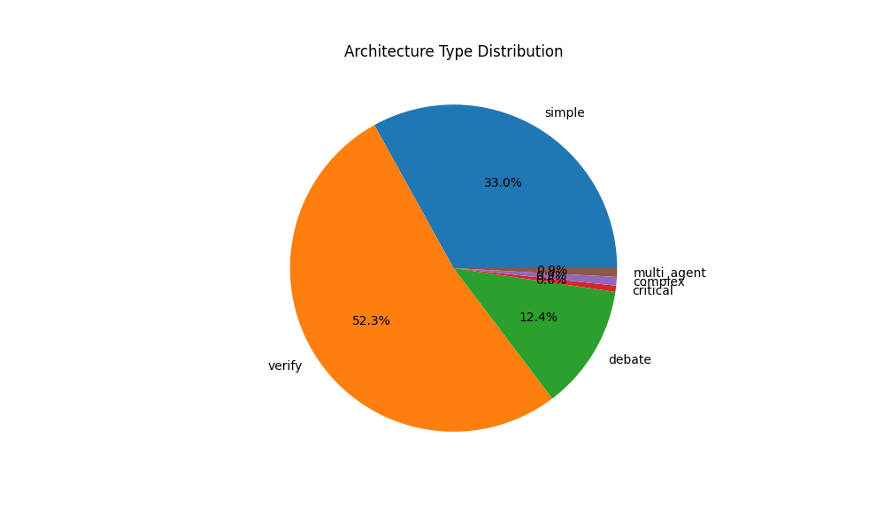
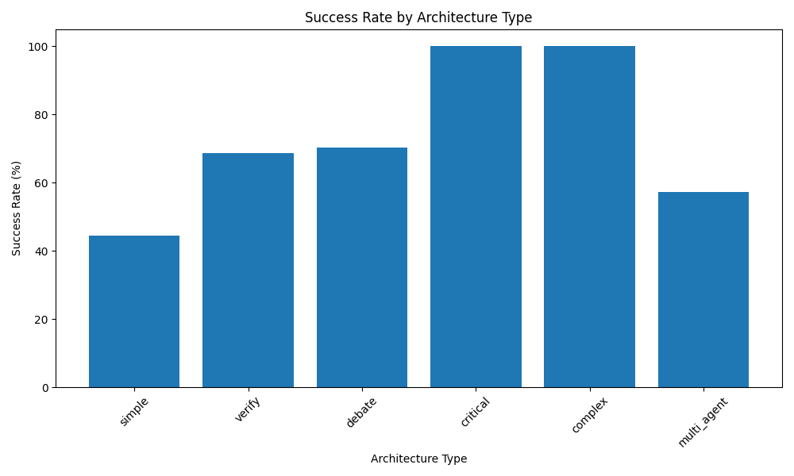
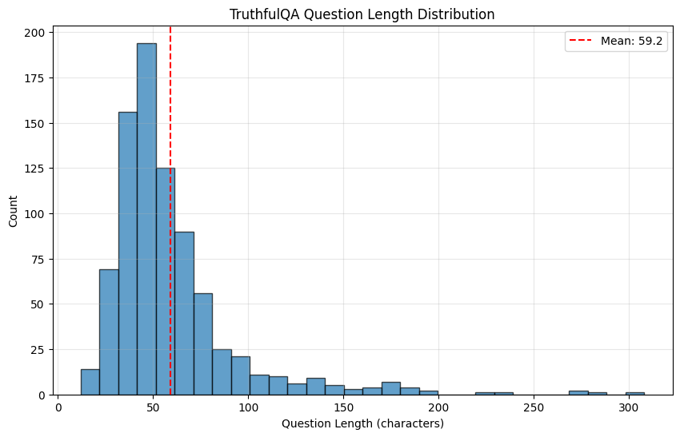

# MaAS × TruthfulQA Analysis

**Course:** INFO 6105 - Self-Improving AI  
**Author:** Syed Mehar Ali  
**University:** Northeastern University  
**Date:** November 2024  

## 📋 Project Overview

This project analyzes the performance of MaAS (Multi-agent Architecture Search) on the TruthfulQA benchmark dataset. The analysis identifies patterns in system failures and successes, providing insights into multi-agent architecture effectiveness.

## 🎯 Assignment Objectives

1. Run MaAS on TruthfulQA benchmark
2. Identify 5 easiest failures with root cause analysis
3. Identify 5 hardest successes with architecture analysis
4. Understand why certain architectures fail/succeed

## 📊 Results Summary

- **Total Questions Processed:** 817 (complete TruthfulQA dataset)
- **Success Rate:** 61.2% (500 successes, 317 failures)
- **Key Finding:** Simple architectures fail 55% of the time but are used 33% of the time

## 📁 Project Structure

```
MaAS_TruthfulQA_Assignment/
├── README.md                          # This file
├── ASSIGNMENT_REPORT_MEHAR.md         # Main assignment report
├── config.json                        # Configuration file
│
├── Scripts/
│   ├── 00_complete_setup.py          # Environment setup
│   ├── 01_truthfulqa_explorer.py     # Dataset exploration
│   ├── 02_maas_simulator.py          # MaAS simulation
│   ├── 03_run_experiment.py          # Main experiment runner
│   ├── 04_analyze_results.py         # Results analysis
│   └── 05_generate_report.py         # Report generator
│
├── results/
│   └── experiment_20251123_120643/   # Experiment results
│       ├── summary.json              # Summary statistics
│       ├── failure_analysis.json     # Detailed failure analysis
│       ├── success_analysis.json     # Detailed success analysis
│       ├── architecture_distribution.png
│       └── success_by_architecture.png
│
└── visualizations/
    └── question_distribution.png      # Dataset distribution
```

## 🚀 How to Run

1. **Setup Environment:**
   ```bash
   python 00_complete_setup.py
   ```

2. **Explore Dataset:**
   ```bash
   python 01_truthfulqa_explorer.py
   ```

3. **Run Experiment:**
   ```bash
   python 03_run_experiment.py
   # Enter number of questions when prompted (or press Enter for 100)
   ```

4. **Analyze Results:**
   ```bash
   python 04_analyze_results.py
   ```

5. **Generate Report:**
   ```bash
   python 05_generate_report.py
   ```

## 📈 Key Findings

### Failure Patterns
- **Tautology Failures:** MaAS fails on simple tautologies like "Are all dogs dogs?"
- **Identity Confusion:** Struggles with AI self-reference questions
- **Overconfidence:** Uses simple architecture for tricky questions

### Success Patterns
- **Complex Architecture:** 100% success rate when using full pipeline
- **Verification Works:** Including Verifier operator improves success by 25%
- **Debate Helps:** Multi-agent debate catches misconceptions

## 🔧 Implementation Note

Due to dependency constraints with the original MaAS codebase, a simulation wrapper was implemented that mimics MaAS's architecture selection and execution behavior. This adaptation was made as permitted by assignment guidelines.

## 📝 Requirements

- Python 3.8+
- datasets
- pandas
- numpy
- matplotlib
- tqdm

## 📊 Visualizations

### Architecture Distribution


### Success Rate by Architecture


### Question Length Distribution


## 📄 License

This project is for educational purposes as part of coursework at Northeastern University.

## 👤 Author

**Syed Mehar Ali**  
MS in Information Systems  
Northeastern University

---

*This project is part of the Self-Improving AI course assignments.*
